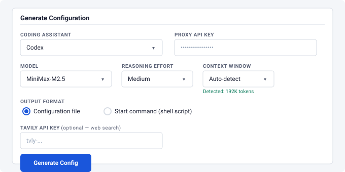

# Codex CLI / Responses API

go-llm-proxy supports OpenAI's [Codex CLI](https://github.com/openai/codex) and any other client that uses the Responses API (`POST /v1/responses`). This works with both native Responses API backends (OpenAI, Azure OpenAI) and backends that only support Chat Completions (vLLM, llama-server, etc.).

## Quick start

The easiest path is the built-in config generator (`--serve-config-generator` flag). Select **Codex** from the coding assistant dropdown, pick your model, and it generates either:

- **Configuration file** — a `config.toml` to save as `~/.codex/config.toml`
- **Start command** — a shell script that passes all settings via `codex -c` overrides, requiring no config file changes



For manual setup, see [Manual configuration](#manual-configuration) below.

## How it works

The proxy auto-detects whether each backend supports the Responses API natively:

1. **First request**: the proxy checks the endpoint with a body-independent `OPTIONS` probe. Only a 2xx or 405 answer whose `Allow` header lists `POST` proves the route exists (CORS-enabled servers answer `OPTIONS` with 2xx on every path, so a bare 2xx is ignored); a 404 proves it is absent. Anything else is inconclusive and the real request decides.
2. **Route available**: the real Responses request is passed through unchanged.
3. **Route absent**: the proxy uses Chat Completions translation. A real request answered by 404/405 with a body such as `{"detail":"Not Found"}` means the route is missing; a 404 carrying an OpenAI-style "model does not exist" error means only the model is wrong and is reported as such instead of translating.
4. **Native 5xx** (`auto` mode only): the request is retried through translation, and the native route is skipped for two minutes. Unpatched vLLM fails on Responses features such as `additional_tools`; translation handles them.

This means:
- **OpenAI, Azure OpenAI** and other native backends work at full fidelity — encrypted compaction, built-in tools, reasoning tokens, everything passes through untouched.
- **vLLM, llama-server, Ollama** and other Chat Completions backends get automatic translation — the proxy converts Responses API requests to Chat Completions and translates the streaming response back.

Detection is cached by backend URL, backend model, and endpoint path, so one bad model name cannot affect another model. Positive results expire after 30 minutes and negative results after 2 minutes, allowing backend upgrades or corrected configuration to take effect without restarting the proxy.

### `responses_mode`

Control how the proxy handles Responses API requests per model:

| Value | Behavior |
|---|---|
| `auto` | Default. Probe the endpoint without a request body and use translation when the route is absent. |
| `native` | Always passthrough. Never translate. Use for backends you know support `/v1/responses`. |
| `translate` | Always translate to Chat Completions. Skip the probe entirely. |

```yaml
models:
  # Auto-detect (default — omit responses_mode or set to "auto"):
  - name: qwen-3.5
    backend: http://gpu-a.internal.example:8000/v1

  # Force translation (skip probe for backends you know are Chat Completions only):
  - name: MiniMax-M2.5
    backend: http://gpu-b.internal.example:8000/v1
    responses_mode: translate

  # Force native passthrough (for OpenAI or backends with full Responses API):
  - name: gpt-4.1
    backend: https://api.openai.com/v1
    responses_mode: native
```

In `auto` mode, the one-time probe adds a single round-trip on the first request per backend. Use `translate` to avoid it for backends you know are Chat Completions only, or `native` to skip it for backends you know support the Responses API.

## Translation details

When translating for non-native backends, the proxy maps between the two API formats.

### Request translation (Responses -> Chat Completions)

| Responses API | Chat Completions |
|---|---|
| `input` (string) | Single user message |
| `input` (array of items) | Messages array (see below) |
| `instructions` + leading `system`/`developer` messages | One merged `system` message (see below) |
| `tools` (function type) | `tools` with nested `function` wrapper |
| `tools` (`namespace`) and `additional_tools` input items | Flattened function tools (see below) |
| `tools` (`custom`, freeform) | Function with one string parameter `input` |
| `tool_choice` | `tool_choice`; `{type: function\|custom, name}` becomes the chat form with the flattened name |
| `max_output_tokens` | `max_completion_tokens` |
| `reasoning.effort` | `reasoning_effort` (passed through untouched; the set of valid values is backend-specific, e.g. `xhigh`) |
| `text.format` (`json_schema`, `json_object`) | `response_format` |
| `temperature`, `top_p`, `user` | Pass through |
| `text.verbosity`, `reasoning.summary`, `reasoning.context`, `include`, `store: false`, `prompt_cache_key`, `client_metadata` | Dropped (no equivalent) |
| `previous_response_id`, `store: true` | HTTP 400 (`previous_response_id_not_supported` / `store_not_supported`): server-side conversation state cannot be honored |

The model's configured sampling `defaults` are applied to the translated request; values the client set always win.

### System prompt and developer messages

Codex sends its base prompt as the first `developer` message(s) and an empty `instructions`. Strict chat templates (Qwen, Gemma and others) reject a system message anywhere but first, and prefix caches need a byte-stable prefix, so the proxy builds **one** `system` message:

- `instructions` (if any), then every message of the **leading contiguous run** of `system`/`developer` messages, in order.
- Parts are joined with exactly one blank line (`"\n\n"`); text parts inside one message are joined the same way. Items that are not messages (`additional_tools`, `reasoning`) do not end the run.

A `developer` (or `system`) message that appears **after** the first user/assistant item (for example "Approved command prefix saved") is mapped per the per-model `developer_role` option:

| `developer_role` | Result |
|---|---|
| `user` (default) | `{role: "user", content: "<developer>\n{text}\n</developer>"}` — accepted by every chat template |
| `system` | `{role: "system", content: "{text}"}` — a mid-conversation system message; strict templates reject it |
| `developer` | `{role: "developer", content: "{text}"}` — only for backends that understand the role |

```yaml
models:
  - name: qwen-3.8
    backend: http://gpu-a.internal.example:8000/v1
    responses_mode: translate
    developer_role: user      # user (default) | system | developer
```

Input item type mapping:

| Responses input item | Chat Completions message |
|---|---|
| `{role: "user", content: "..."}` | `{role: "user", content: "..."}` |
| `{role: "developer"\|"system", ...}` | Merged system message, or per `developer_role` (see above) |
| `{type: "message", role: "assistant", content: [...]}` | `{role: "assistant", content: "..."}` |
| `{type: "function_call", call_id, name, arguments}` | Merged into assistant message `tool_calls` (name flattened if `namespace` is set) |
| `{type: "custom_tool_call", call_id, name, input}` | Assistant `tool_calls` entry with arguments `{"input": "..."}` |
| `{type: "function_call_output"\|"custom_tool_call_output", call_id, output}` | `{role: "tool", tool_call_id, content}` |
| `{type: "reasoning", ...}` | Its text (`content` reasoning_text parts, else `summary`) becomes `reasoning_content` on the next assistant message; `encrypted_content` is ignored |
| `{type: "additional_tools", tools: [...]}` | Not a message: its tools are added to the request's tools |
| `{type: "compaction", ...}` | Dropped (no equivalent) |

Server-side tool types (`web_search_preview`, `code_interpreter`, ...) are dropped since Chat Completions backends cannot execute them; `web_search` is handled by the proxy's search processor when configured.

### Namespaces and freeform tools

Codex groups some tools in a `namespace` (for example `multi_agent_v1`) and, for auto-review, delivers its tools in an `additional_tools` input item. Chat Completions has neither, so each namespaced tool becomes a plain function:

- A top-level tool keeps its name.
- A tool `NAME` in namespace `NS` is exposed as **`NS__NAME`** (two underscores), characters outside `[A-Za-z0-9_-]` replaced by `_`, at most 64 characters (longer names are cut and given an 8-hex hash suffix).
- The implicit `functions` namespace drops its prefix when the bare name is free, so the reviewer sees `exec`, not `functions__exec`.
- On a collision (a top-level tool always wins) the full `NS__NAME` is tried, then `_2`, `_3`, ...

When the model calls such a tool, the response carries the original identity: a `function_call` item with `name: NAME` and `namespace: NS`.

A `custom` (freeform) tool — `exec`, `apply_patch` — becomes a function whose single parameter is the string `input`; a lark/regex grammar is appended to its description for the model to follow. The model's call is returned as a `custom_tool_call` item (`input` = the string, plus `namespace` when it has one), with `response.custom_tool_call_input.delta` / `.done` events (the whole input is sent in one delta when the call completes) and the usual `output_item.added` / `.done`.

### Auto-review

Codex's auto-review (`approvals_reviewer = "auto_review"`) sends a separate streamed request with `model: "codex-auto-review"`, no top-level `tools`, an `additional_tools` item, and a JSON-schema `text.format`. Point that model name at a configured model with an alias:

```yaml
aliases:
  codex-auto-review: qwen-3.8
```

The request translates as above; `text.format` becomes `response_format`, and the final message is a normal `output_text` message holding the JSON verdict. When structured output was requested, the proxy buffers the reply and strips Markdown fences or prose around the JSON so Codex can parse it. Codex gives the reviewer 90 seconds and treats any failure as a denial.

### Response translation (Chat Completions -> Responses)

Streaming responses are translated event-by-event:

| Chat Completions chunk | Responses API event |
|---|---|
| First chunk | `response.created` |
| `delta.reasoning` / `reasoning_content` / `<think>` | `reasoning` item with `response.reasoning_summary_text.delta` **and** `response.reasoning_text.delta`; done item has both `summary` and `content: [{type: "reasoning_text"}]` |
| `delta.content` | `output_item.added`, `content_part.added`, `response.output_text.delta` |
| `delta.tool_calls[i]` (new `index`, or a new `id` on the same index) | `response.output_item.added` (`function_call` or `custom_tool_call`) |
| `delta.tool_calls[i].function.arguments` | `response.function_call_arguments.delta` (freeform tools: one `response.custom_tool_call_input.delta` at the end) |
| `finish_reason: "stop"` / `"tool_calls"` | All `*.done` events, `response.completed` |
| `finish_reason: "length"` | `response.incomplete` |
| `finish_reason: "content_filter"` | `response.failed` (`content_filter`) |
| Usage chunk | `usage` in `response.completed`, including `input_tokens_details.cached_tokens` and `output_tokens_details.reasoning_tokens` |
| Stream ends without `finish_reason`, read error, or an `{"error": ...}` chunk | `response.failed` (`stream_truncated`, `stream_interrupted`, `upstream_error`); cut-off tool calls are never completed |

Tool calls are tracked by their `index`, so deltas without an `id`, repeated ids and id-less calls are all handled. A stream that ends without `[DONE]` but after a `finish_reason` still completes (a warning is logged). SSE lines up to 16 MB are accepted.

Non-streaming responses are translated as a single JSON object.

### Errors

An upstream error that arrives before any byte is streamed is returned as a real HTTP error with an OpenAI-style body `{"error": {"message", "type", "code"}}`; once a stream is open it becomes a `response.failed` event. Raw backend bodies are never forwarded; URLs and IP addresses are removed from the messages that are.

| Upstream | Client sees | `code` |
|---|---|---|
| 400 / 4xx naming a context-length problem | 400 | `context_length_exceeded` (Codex compacts and retries) |
| other 400 / 422 | 400 | `invalid_prompt` |
| 401 / 403 (the proxy's backend credential was rejected) | 502 | `upstream_auth_error` |
| 429 | 429 (+ `Retry-After`) | `rate_limit_exceeded` |
| 503 | 503 (+ `Retry-After`) | `server_is_overloaded` |
| other 5xx | same status | `upstream_error` |
| backend unreachable / timeout | 502 / 504 | `upstream_unreachable` / `upstream_timeout` |

Failed attempts count against the backend's circuit breaker.

### Timeouts

The model's `timeout` (default 300 s) bounds connecting and waiting for response headers, and non-streaming bodies. For a streaming request it is disarmed once the upstream answers with an event stream, so long generations are never cut; liveness then comes from the client's own inactivity handling.

## Context compaction

Long Codex sessions may trigger context compaction to manage the growing conversation history.

**Native backends**: The `/v1/responses/compact` request is passed through directly, preserving OpenAI's encrypted compaction format.

**Translated backends**: The proxy sends the conversation to the backend with a summarization prompt (merged into the single leading system message) and returns the result as preserved user messages plus a summary assistant message. `<think>…</think>` blocks are stripped from the summary. This is functionally similar to Codex's own inline compaction path for non-OpenAI providers.

**Note**: When using the config generator's custom provider setup (`model_provider = "go-llm-proxy"`), Codex automatically uses its client-side inline compaction, which goes through the regular `/v1/responses` endpoint. The `/v1/responses/compact` handler serves as a fallback for alternative configurations.

## Web search

Codex's built-in `web_search_preview` tool is a server-side OpenAI feature. It works with native OpenAI backends but not with local models directly.

The proxy can handle web search transparently for local models:

**Option 1: Proxy-side search (recommended)** — Configure a Tavily API key in the proxy's `processors` block:

```yaml
processors:
  web_search_key: tvly-your-key
```

The proxy automatically converts Codex's `web_search_preview` tool to a function tool. When the backend model calls `web_search`, the proxy executes a Tavily search and injects the results. Codex sees only the final response. No client-side configuration needed — the config generator omits MCP setup when the proxy has search configured.

**Option 2: Client-side MCP** — For local/proxy models, the config generator disables the built-in search (`web_search = "disabled"`) and optionally configures [Tavily](https://tavily.com/) as an MCP server. Enter your Tavily API key in the config generator to include it.

The generated TOML includes:

```toml
web_search = "disabled"

[mcp_servers.tavily]
url = "https://mcp.tavily.com/mcp"
bearer_token_env_var = "TAVILY_API_KEY"
```

Set the environment variable before running Codex:

```bash
export TAVILY_API_KEY=tvly-your-key
```

## Manual configuration

If you prefer not to use the config generator, create `~/.codex/config.toml`:

```toml
model = "your-model-name"
model_provider = "go-llm-proxy"
model_reasoning_effort = "medium"
web_search = "disabled"

[model_providers.go-llm-proxy]
name = "Go-LLM-Proxy"
base_url = "http://your-proxy-host:8080/v1"
env_key = "OPENAI_API_KEY"
wire_api = "responses"
```

Then set your proxy API key:

```bash
export OPENAI_API_KEY=your-proxy-api-key
```

### Key fields

| Field | Purpose |
|---|---|
| `model_provider` | Must match the name in `[model_providers.*]` |
| `base_url` | Your proxy URL including `/v1` |
| `env_key` | Name of the env var holding the API key |
| `wire_api = "responses"` | Tells Codex to use the Responses API (required) |
| `model_reasoning_effort` | Backend-specific; commonly `"low"`, `"medium"`, `"high"`, or `"xhigh"` |
| `web_search` | Set to `"disabled"` for non-OpenAI backends |

## Context window

Codex uses the model's context window size to manage conversation history and trigger compaction. The proxy auto-detects this from each backend at startup:

- **vLLM backends**: reads `max_model_len` from `GET /v1/models`
- **llama-server backends**: reads `meta.n_ctx_train` from `GET /v1/models`
- **Anthropic backends**: reads `max_input_tokens` from `GET /v1/models/{model_id}`
- **Cloud APIs without a models endpoint** (e.g., MiniMax cloud, Zhipu): detection fails gracefully — a warning is logged

Detection runs asynchronously at startup and does not block the server. Results are cached and served through the proxy's `/v1/models` endpoint in the `max_model_len` field.

### Manual override

For backends that don't report their context window, set it explicitly in `config.yaml`:

```yaml
- name: MiniMax-M2.7
  backend: https://api.minimax.io/anthropic
  type: anthropic
  context_window: 1048576   # 1M tokens
```

Omit the field or set it to `0` for auto-detection. Any positive value skips the backend query and uses the configured value directly.

### Config generator

The Codex config generator includes a **Context Window** dropdown. When the selected model has a detected context window, the hint shows the value (e.g., "Detected: 192K tokens"). When detection returned nothing, the dropdown is highlighted amber with "Not detected — set manually for best results" to prompt manual selection. The chosen value is included as `model_context_window` in the generated Codex config.

## Known limitations

These limitations apply only to **translated backends** (Chat Completions). Native passthrough backends (OpenAI, Azure OpenAI, or any backend that supports `/v1/responses`) have full fidelity — the proxy is transparent and all Responses API features work exactly as they would with a direct connection.

### Translation scope

The translation layer targets **Codex CLI and coding-agent workflows**: text generation, function calling, and tool use. It is not a spec-complete generic Responses API adapter. Specifically:

- **Non-function tools are converted or dropped.** `web_search_preview` is converted to a proxy-side function tool when `web_search_key` is configured in the `processors` block (the proxy executes Tavily searches transparently and emits `web_search_call` output items for Codex's native search UI). Other server-side tools (`code_interpreter`, `file_search`) are dropped since Chat Completions backends cannot execute them.
- **Reasoning is fully supported.** Backend reasoning tokens (`delta.reasoning` in Chat Completions) are translated to Responses API `reasoning` output items with streaming `reasoning_summary_text.delta` events, giving Codex its native thinking display.
- **Compaction is fully supported.** The proxy's `/v1/responses/compact` endpoint uses a summarization fallback for Chat Completions backends — not protocol-equivalent to OpenAI's encrypted compaction, but functionally equivalent for maintaining conversation context.
- **All tool call output types are supported.** `function_call_output`, `local_shell_call_output`, `custom_tool_call_output`, and `mcp_tool_call_output` are all translated to Chat Completions `tool` messages.
- **Some input item types are dropped.** `compaction`, `tool_search_call`, `tool_search_output`, `web_search_call`, `image_generation_call`, and `mcp_list_tools` items from conversation history are skipped during translation since they have no Chat Completions equivalent. These only appear in history from previous native OpenAI sessions — the proxy never produces them, so this is a non-issue in practice.
- **Assistant content is simplified.** Structured content arrays on assistant messages are reduced to concatenated text from `output_text` parts. Other content types (e.g., images from `image_generation_call`) are not preserved through translation.

### Backend compatibility

The translated Chat Completions output uses standard fields (`messages`, `tools`, `stream`, `max_completion_tokens`, `reasoning_effort`, `response_format`, etc.). Compatibility depends on what each backend supports:

- **vLLM** has comprehensive Chat Completions support including tool calling, `response_format`, and `max_completion_tokens`. Recent versions expose `/v1/responses` but multi-turn input validation may not be fully compatible with Codex. **Recommend `responses_mode: translate` for vLLM** unless you have explicitly validated your version with Codex end-to-end.
- **llama-server** (llama.cpp) supports core Chat Completions (`/v1/chat/completions`) but feature coverage varies by version — `response_format`, `parallel_tool_calls`, and reasoning-related fields may not be available in older builds. Test with your version.
- **Ollama** supports basic Chat Completions. Tool calling support varies.

The proxy only includes optional fields (like `response_format` or `reasoning_effort`) when the Codex client sends them, so a basic session will work with minimal backend support.

### Other limitations

- **Token counts are not available for native passthrough.** Usage logging records request/response byte counts but not token counts for passthrough requests (tokens would require buffering and parsing the full response).
- **WebSocket transport is not supported.** Codex falls back to HTTP SSE automatically, which the proxy supports fully.

## Proxy-side configuration

On the proxy side, no special configuration is needed. Any OpenAI-type model in your `config.yaml` is automatically available via the Responses API. The proxy handles detection and translation transparently.

The only proxy-side option is `responses_mode` on a model, which controls whether the proxy probes, passthroughs, or translates Responses API requests. See [`responses_mode`](#responses_mode) above for details.
